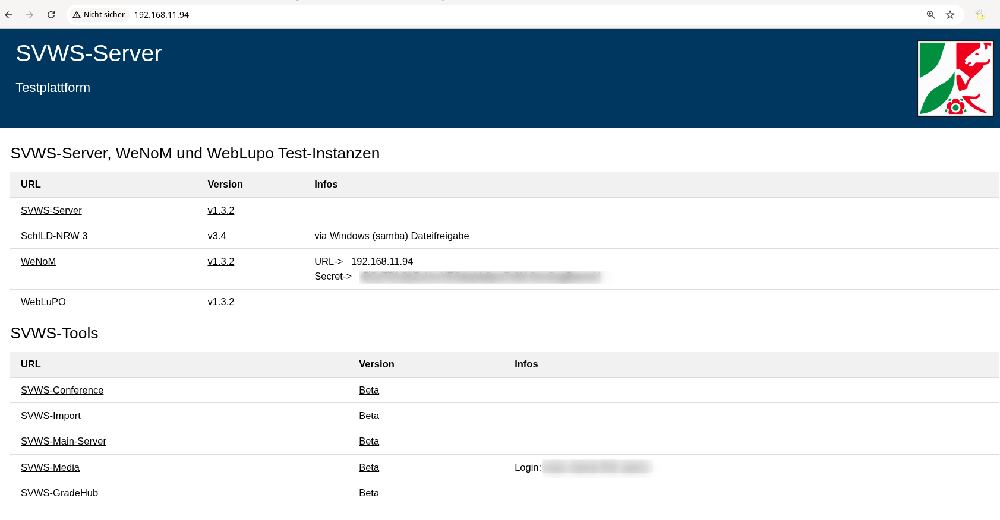

# Installationsskripte gezielt auswählen

## Vor dem Start: Was soll auf welchem Rechner entstehen?

Die Skripte sind **Werkzeuge für vorbereitete Testsysteme**, keine universelle Installation für jeden Raum. Auf einem Windows-Arbeitsplatz führst Du diese Bash-Dateien nicht als Windows-Installer aus. Ein Proxmox-Host, eine Debian-VM und ein Docker-Container sind unterschiedliche Ausführungsorte.

| Aufgabe | Richtiger Weg |
| --- | --- |
| Einen zentralen Docker-Schulungsserver bereitstellen | [Docker-Anleitung](../Docker_Schulungsserver/index.md): Engine installieren, Projekt vorbereiten, starten, Daten getrennt importieren |
| SVWS direkt auf einer frischen Debian-VM installieren | [Linux-Installer](#linux-installer) mit ausgewähltem offiziellem Release |
| Eine Übungsdatenbank bereitstellen oder zurücksetzen | AdminClient; für einen kontrollierten Einzelimport die folgenden Werkzeuge |
| Proxmox-Container anlegen oder bedienen | [Proxmox-Anleitung](../Proxmox_Schulungsserver/index.md); nur auf dem PVE-Host |
| Viele Anwendungen aus Entwicklungsquellen bauen | Kein Standardweg; experimentelle Helfer sind für den normalen Aufruf gesperrt |


## Skripte beziehen und prüfen

Du benötigst Bash und die jeweils verwendeten Werkzeuge. Der Downloader setzt `curl` und `jq` voraus und installiert keine Pakete selbst:

```bash
FBM_REF=6b540c8da74187caed87b4b561a553add2f61fc7 bash download_all_scripts.sh ./fbm-installationsskripte
```

Der [Downloader](https://raw.githubusercontent.com/Raffenberg/SVWS_FBM/6b540c8da74187caed87b4b561a553add2f61fc7/Fachberatung_Anleitungen/Test-_und_Schulungsserver/Installationsskripte/download_all_scripts.sh) lädt die Sammlung in einen neuen Ordner. Die Downloadlinks sind auf den Quellstand `6b540c8da741` festgelegt.

Docker- und Proxmox-Werkzeuge liegen in eigenen Geschwisterordnern. Erhalte bei einem vollständigen Checkout die Verzeichnisstruktur; mehrere Wrapper benötigen die Datei aus `../Installationsskripte/`.

## Linux-Installer {#linux-installer}

[install_svws_testserver_linuxinstaller.sh](https://raw.githubusercontent.com/Raffenberg/SVWS_FBM/6b540c8da74187caed87b4b561a553add2f61fc7/Fachberatung_Anleitungen/Test-_und_Schulungsserver/Installationsskripte/install_svws_testserver_linuxinstaller.sh) lädt das **offizielle SVWS-Release-Skript** in einen neuen Arbeitsordner und bereitet eine geschützte `.env` vor. Es ist für eine frische Debian-Test-VM vorgesehen, nicht für den Proxmox-Host oder für die Reparatur einer bestehenden Installation.

```bash
bash install_svws_testserver_linuxinstaller.sh -v 1.4.1 -p EIN_EIGENES_LANGES_PASSWORT --prepare-only
```

Prüfe danach Skript und Einstellungen. Ohne `--prepare-only` wird der offizielle Installer mit Root-Rechten ausgeführt. Beide Parameter `-v` und `-p` sind Pflicht. Der Passwortwert muss mindestens zwölf Zeichen aus Buchstaben, Ziffern, `_` und `-` enthalten; diese Einschränkung vermeidet Mehrdeutigkeiten beim Einlesen der erzeugten Umgebung durch den Upstream-Installer.

Die **tatsächliche Installation und Paketwahl** bestimmt das jeweilige Release. Die Vorbereitungsprüfung ersetzt deshalb keine Installation auf der vorgesehenen VM. Für Updates einer bestehenden Installation gilt der [offizielle Linux-Updateweg](https://doku.svws-nrw.de/deployment/Linux-Installer/#update) mit der ursprünglichen Konfiguration.

## Eine SQLite-Datei gezielt importieren

Bevorzuge für die normale Moderation den AdminClient. Der Skriptweg [create_svws_testdbs.sh](https://raw.githubusercontent.com/Raffenberg/SVWS_FBM/6b540c8da74187caed87b4b561a553add2f61fc7/Fachberatung_Anleitungen/Test-_und_Schulungsserver/Installationsskripte/create_svws_testdbs.sh) benötigt eine lokale, echte SQLite-Datei und ein ausdrücklich gewähltes Zielschema. Er lädt nicht mehr stillschweigend ein ganzes Entwicklerdatenbank-Repository.

```bash
read -r -s -p "MariaDB-Root-Passwort: " SVWS_ROOT_PASSWORD; echo
read -r -s -p "Neues Schema-Passwort: " SVWS_SCHEMA_PASSWORD; echo
export SVWS_ROOT_PASSWORD SVWS_SCHEMA_PASSWORD
bash create_svws_testdbs.sh -f ./uebung.sqlite -n platz01 -u platz01 -s SERVERADRESSE -P 8443
unset SVWS_ROOT_PASSWORD SVWS_SCHEMA_PASSWORD
```

Ersetze `SERVERADRESSE` durch das Zielsystem. Die Zertifikatsprüfung bleibt standardmäßig aktiv. `--insecure` ist nur eine bewusst gewählte Ausnahme für eine bereits identifizierte isolierte Testinstanz mit selbstsigniertem Zertifikat. Es wird nicht als allgemeiner Standard vorausgesetzt.

Ein Transport-/HTTP-Fehler bricht den Aufruf ab. Prüfe danach Schema, Datenstand und Anmeldung fachlich im AdminClient. Wiederholtes Importieren in ein bereits belegtes Schema ist kein nachgewiesener Resetweg.

[docker_multimport_sqlite.sh](https://raw.githubusercontent.com/Raffenberg/SVWS_FBM/6b540c8da74187caed87b4b561a553add2f61fc7/Fachberatung_Anleitungen/Test-_und_Schulungsserver/Docker_Schulungsserver/docker_multimport_sqlite.sh) ist trotz des historischen Namens jetzt ein **Einzelimport-Wrapper**. Er benötigt die lokale Datei, den Schemanamen und den ausdrücklich gewählten Schema-Benutzer und einen laufenden Container mit veröffentlichtem IPv4-HTTPS-Port. Er installiert keine zusätzlichen Werkzeuge im Container.

## Ein einzelnes Schema entfernen

[delete_all_svws_dbs.sh](https://raw.githubusercontent.com/Raffenberg/SVWS_FBM/6b540c8da74187caed87b4b561a553add2f61fc7/Fachberatung_Anleitungen/Test-_und_Schulungsserver/Installationsskripte/delete_all_svws_dbs.sh) löscht nicht mehr automatisch alle Datenbanken. Der Dateiname bleibt aus Kompatibilitätsgründen erhalten.

```bash
bash delete_all_svws_dbs.sh --schema platz01 -s SERVERADRESSE -P 8443
```

Dies ist nur eine Vorschau. Die echte Aktion braucht zusätzlich `--execute --confirm-server SERVERADRESSE` und die gesetzte Variable `SVWS_ROOT_PASSWORD`. Sichere vorher nötige Ergebnisse und kontrolliere die Zuordnung des Arbeitsplatzes. Nutze anschließend den vereinbarten Wiederherstellungsweg.

## Zusatzanwendungen und experimentelle Aufbauten

WeNoM und WebLuPO sind gesonderte Anwendungen. Apache-/PHP-Konfiguration, DNS, Zertifikate und die Kopplung an das richtige Schema sind zusätzliche Aufgaben. Eine korrekt entpackte ZIP-Datei bestätigt noch keine funktionierende Notenübertragung.

Der frühere All-in-one-Aufbau mischt Docker, Samba, Apache, nginx und Builds aus Entwicklungsquellen. Er ist deshalb **keine wartungsarme Empfehlung**. Das gilt ebenso für Quellenbuilds, automatisches `wipe`, ungeprüfte Passwortmigration und Mehrfach-WeNoM.

Fünf entsprechende Bestandsskripte brechen beim normalen Aufruf mit Exitcode 78 ab. Für eine gesonderte Entwicklungskopie kann ein fachkundiger Bearbeiter mit `FBM_EXPERIMENTAL=1` weiter am Code arbeiten; das ist ausdrücklich keine Integrationsfreigabe.

::: details Abbildung des früheren All-in-one-Beispiels
Die Grafik dokumentiert den früheren Funktionsumfang, nicht einen aktuell freigegebenen Installationsweg.


:::


## Prüfbericht {#pruefbericht}

[Technische Befunde und Laufzeitnachweise](/hilfe/skript-pruefbericht) stehen unter Redaktion.
