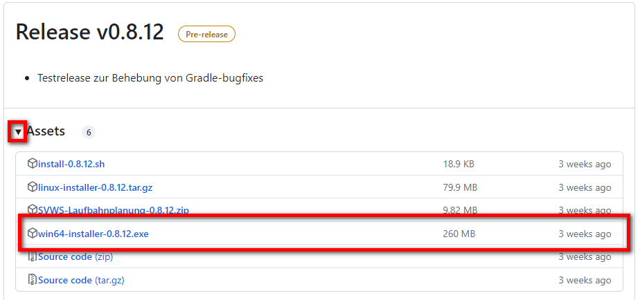
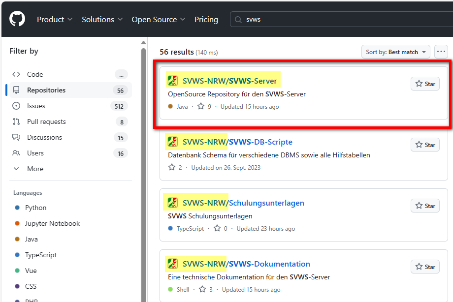

# Installation vom SVWS-Server

Ergänzende ältere Bildfolge. [Aktuelle Einrichtung](/umgebungen/einrichten).

### Download der Installationsdateien
Lade Dich im SVWS-NRW-Repository die notwendigen Installationspakete herunter.  

Die aktuellen Installationsdateien vom SVWS-Server befinden sich im GitHub: 
https://github.com/SVWS-NRW/SVWS-Server/releases

Auch ohne diesen Link, findet man die Downloadseite auf der Homepage von GitHub. Unter www.github.com kann man ohne Benutzerkonto nach SVWS suchen:

Nach Auswahl des Repositorys SVWS-NRW/SVWS-Server kommt man über Releases auf die Downloadseite:

> [!TIP] 
> Hier findet man noch viele andere öffentliche Reporitorys von SVWS-NRW. Man erkennt diese direkt an dem NRW-Wappen Icon.

### Installation Starten
Führe die Installation als Administrator aus!

> [!TIP] 
> Eine gute Anleitung findest Du auch im [Wiki](https://schild3.svws-nrw.de/administration/installation/installation-svws-server-und-schild-nrw-3.html#installation-des-svws-servers)
