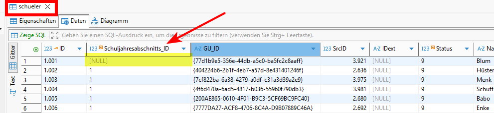
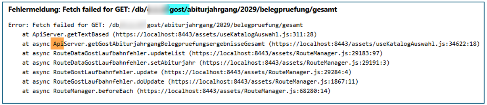
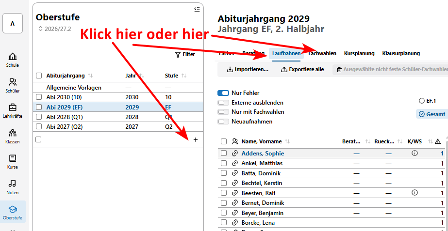

# Oberstufen-App – Schüler ohne Schuljahresabschnitt

**Veröffentlicht am 12.10.2026.**

Bei den beschriebenen Fällen fehlte bei einzelnen Schülern die Schuljahresabschnitts_ID. Halte Meldung und Programmversion fest und [kläre den Fall mit der Landesfachberatung](/beratung/anfrage-vorbereiten).

## In der Datenbank sieht das so aus:
|  |
|---------------|

## Wie kommt der Null-Eintrag zustande?

Bei den mir bekannten Fällen, handelt es sich um SuS, die in Schild2 angelegt wurden und vor einem Neustart von Schild2 wieder gelöscht wurden oder sofort auf Abgang gesetzt wurden. Die SuS haben auch keine Lernabschnittsdaten und waren nie an der Schule.

## Wie erkenne ich den Fehler im Client?
Die Fehlermeldung kann beim Anlegen eines Abiturjahrgangs auftreten oder beim Klick auf einen Unterreiter einer Abiturjahrgangs:

|  |
|---------------|

Der Anwender erhält in etwa eine solche Rückmeldung:
|  |
|---------------|

## Was rate ich den Schulen?
Die Behebung war zum Veröffentlichungszeitpunkt für ein folgendes Release angekündigt. Wenn man das Release nicht abwarten möchte, kann die Schuljahresabschnitts_ID in der Datenbank nachtragen werden oder der Schüler kann nach Rücksprache aus der Datenbank gelöscht werden - sofern der Schüler nie an der Schule war.

[Weitere Lösungen](/beratung/) · [Hinweise nach Datum](/wissen/aktuelles)
