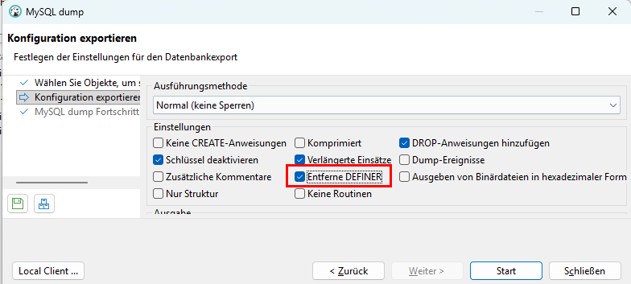
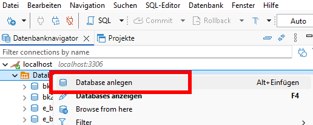
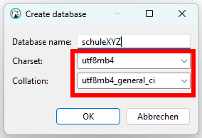
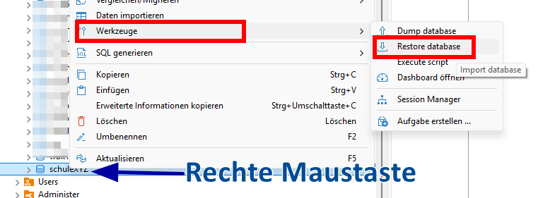
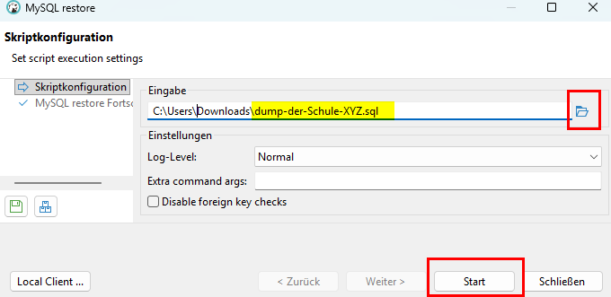
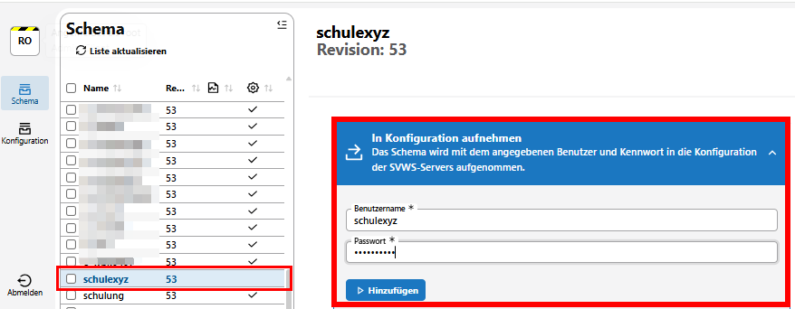

# SQL-Dump mit DBeaver importieren

**Veröffentlicht am 09.03.2026.**

Beim SQL-Import können DEFINER-Angaben den Zugriff auf das importierte Schema verhindern. Für den üblichen Datenaustausch verwende ein [SQLite-Backup](/Datenbanken/problemdatenbanken).

## SQL-Dump vorbereiten

Die Ursache der Fehlermeldung im Client lag an der Erstellung des Dump. Der exportierte sql-Dump beinhaltete den ursprünglichen Datenbankbenutzer. Dadurch konnte das Schema nicht in die Konfigurationsdatei aufgenommen werden.

Folgender Workflow spiegelt meine "Trail and Error" Lösung wieder:

**Lösung 1: Dump ohne Definer erstellen (lassen)**
| |
|---------------|

**Lösung 2: Definer aus dem Dump entfernen**
Öffne die sql-Datei mit einem Texteditor (z.B. Notepad++) und entfernen alle Definer-Angaben wie beispielsweise:

```sql
CREATE DEFINER=`schule123`@`%` VIEW ...

wird zu
CREATE  VIEW ...
```

Nun kann der Dump fehlerfrei mit DBeaver erstellt werden und in die Konfigurationsdatei aufgenommen werden

**Schritt 1: Neue Datenbank anlegen:**

| |
|---------------|

Achte auf die UTF-8 Einstellung:
| |
|---------------|

**Schritt 2: Dump importieren:**
| |
|---------------|

Importdatei auswählen:
| |
|---------------|

**Schritt 3: Datenbank-Schema in die Konfiguration aufnehmen**
Ohne diesen Schritt ist die Datenbank nicht im Browser auswählbar
| |
|---------------|

**Hinweis:**
Aufgrund von unterschiedlichen Zeichensätzen beim Erstellen und Einlesen eines Dumps kommt es manchmal beim Importieren zu Fehlermeldungen. Einfacher ist es mit dem SQLite-Format.

[Weitere Lösungen](/beratung/) · [Hinweise nach Datum](/wissen/aktuelles)
