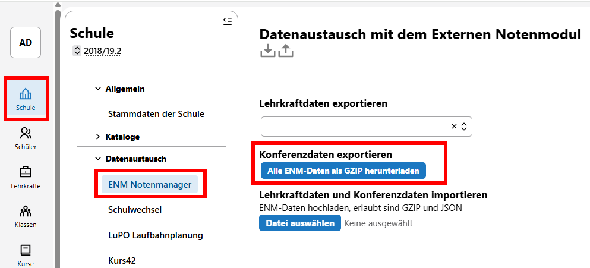
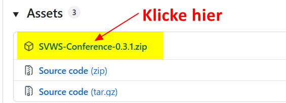
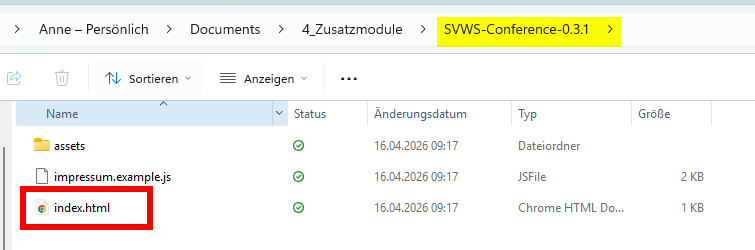
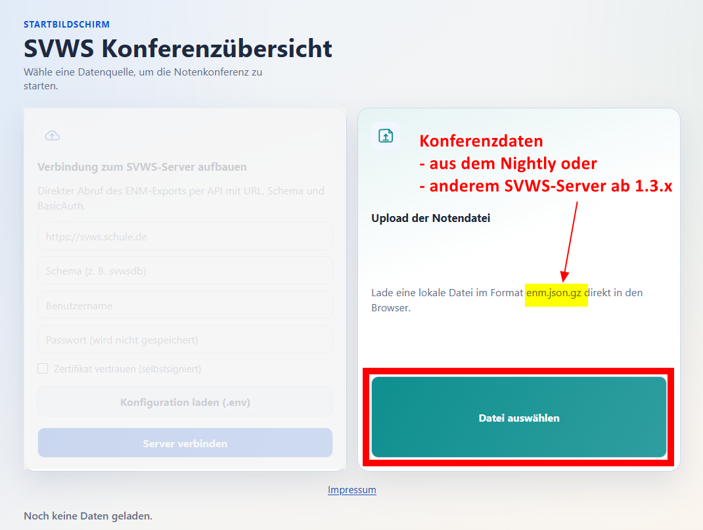

# Konferenzübersicht verwenden

**Veröffentlicht am 20.04.2026.**

Der Beitrag beschreibt SVWS-Conference 0.3.1 und den damaligen Testablauf mit SVWS-Server 1.3.0.

Download und Dokumentation findest Du unter [Software und Dokumentationen](/wissen/links).

## Stand des Beitrags vom April 2026
+ Download: Über die Homepage: https://www.svws.nrw.de/ (voraussichtlich Ende April)
+ Beschriebene Version: Release 0.3.1
+ Kompatible SVWS-Version: Ab SVWS-Release v1.3.0 (Ende April 2026)
+ Anleitung: https://doku.svws-nrw.de/svws-module/svws-konferenzuebersicht/

## Damaliger Testablauf
Die folgende Bildfolge dokumentiert den damaligen Aufbau mit einem Entwicklungsstand des SVWS-Servers.

**Schritt 1: Konferenzdaten aus dem SVWS-Server holen**
Unter Schule/Datenaustausch kannst du die Konferenzdaten exportieren:
|  |
|---------------|

Hinweis:
Die exportierte Konferenzdatei heißt enm.json.gz und befindet sich vermutlich in deinem Download-Ordner.
Du musst die Datei nicht entpacken!

**Schritt 2: Download von SVWS-Conference**
Speichere und entpacke die Datei SVWS-Conference-0.3.1.zip von der Downloadseite.
|  |
|---------------|

**Schritt 3: SVWS-Konferenzansicht starten**
Starte die Konferenzansicht mit Doppelklick auf index.html:
|  |
|---------------|

**Schritt 4: Konferenzdatei öffnen**
Öffne die in Schritt 1 exportierte Datei enm.json.gz:
|  |
|---------------|

## Damalige Ankündigung
Mit dem kommenden SVWS-Release Ende April kann die SVWS-Konferenzansicht auch in Schulen eingesetzt werden. Die zip-Datei steht den Schulen dann auf der Homepage zum Download bereit.

## Grenzen der SVWS-Konferenzansicht
Es sind nur Leistungsdaten des aktuellen Abschnittes sichtbar.

[Weitere Lösungen](/beratung/) · [Hinweise nach Datum](/wissen/aktuelles)
