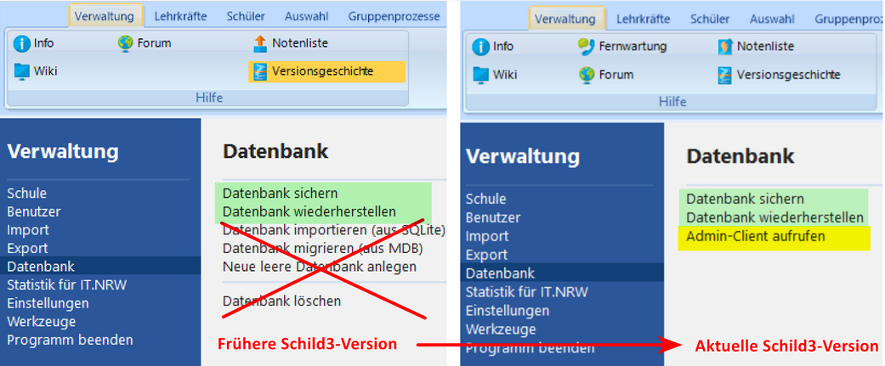
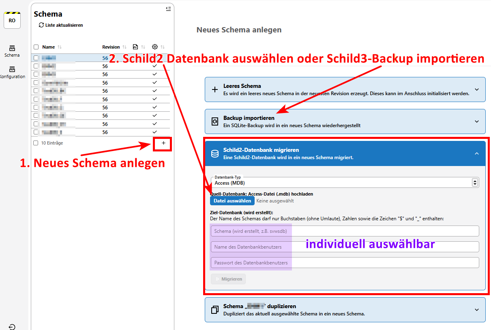

# Datenbanken über den AdminClient migrieren

**Veröffentlicht am 23.02.2026.**

Seit SchILD-NRW 3.3.0 werden Migration, Import und das Anlegen von Datenbanken im AdminClient ausgeführt.

In der Schild3-Version 3.3.0 wurden folgende Datenbankoptionen entfernt:
+ Datenbank importieren
+ Datenbank migrieren
+ Leere Datenbank anlegen
+ Datenbank löschen

Stattdessen besteht nun die Möglichkeit, den Admin-Client über SchILD3 aufzurufen:
|   |
|---------------|

### Wie migriere oder importiere ich nun am einfachsten eine Datenbank?

Ganz einfach: über den Admin-Client.

Die Migration konnte auch bisher schon über den Admin-Client durchgeführt werden – am gewohnten Workflow hat sich also nichts geändert:
|   |
|---------------|

[Weitere Lösungen](/beratung/) · [Hinweise nach Datum](/wissen/aktuelles)
