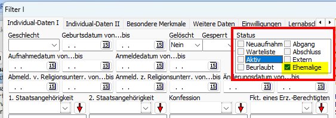
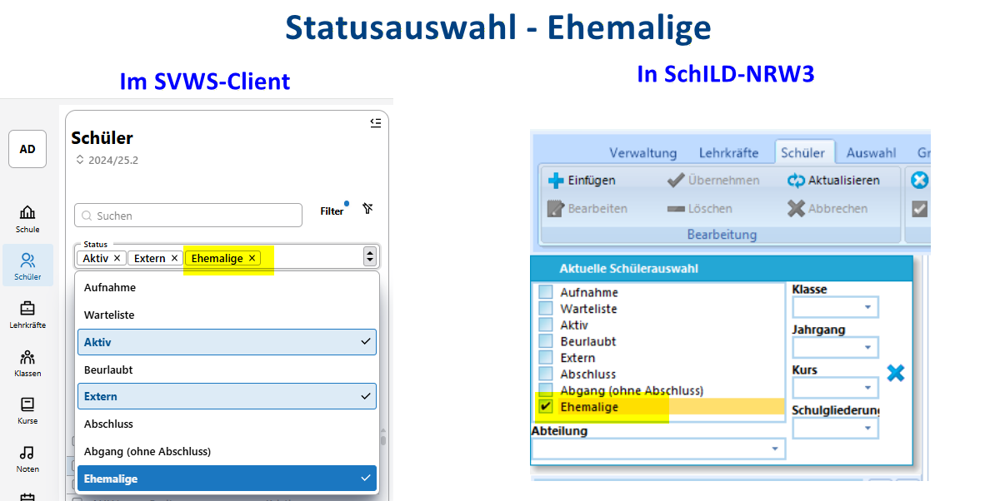
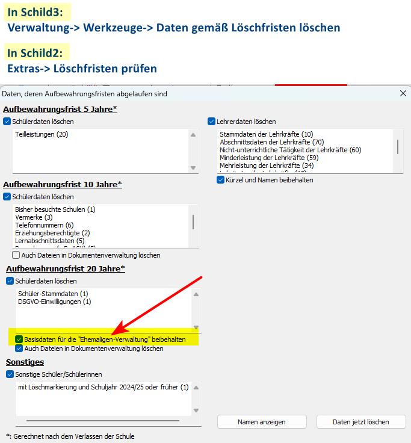

# Schülerstatus Ehemalige verwenden

**Veröffentlicht am 11.05.2026.**

Den Status **Ehemalige** kannst Du in SchILD-NRW 3 und im SVWS-Client über den Schnellfilter auswählen.

Nach einer Migration können bereits Datensätze mit diesem Status vorliegen.

Der Status "Ehemalige" ist nämlich gar nicht neu. Er ist aber bei SchILD2 ein wenig versteckt. Man findet ihn dort nur beim Filter I als Auswahlkriterium:

|   |
|---------------|

In SchILD3 und im SVWS-Client kann man ehemalige Schüler auch direkt im Schnellfilter auswählen:

|   |
|---------------|

### Was ist der Unterschied zwischen Abschluss und Ehemalige?
Bei ehemaligen Schülern sind nur noch Adressdaten hinterlegt, da die 20 jährige Aufbewahrungsfrist abgelaufen ist. Die Schulen müssen bei der Speicherung der Ehemaligen-Infos die VO-DV I und II berücksichtigen.

### Wie bekommt ein Schüler den Status "Ehemalige"?

Beim Prüfen der Löschfristen gibt es die Option, die Basisdaten für die Ehemaligen-Verwaltung beizubehalten:

|   |
|---------------|

[Weitere Lösungen](/beratung/) · [Hinweise nach Datum](/wissen/aktuelles)
