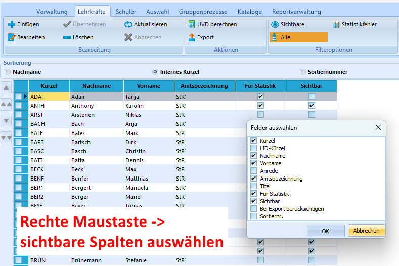
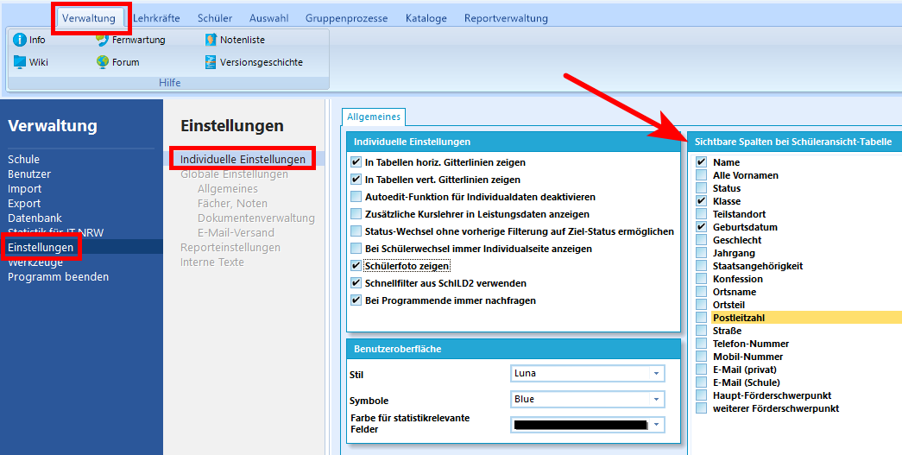

# Spalten im Lehrercontainer einblenden

**Veröffentlicht am 18.05.2026.**

Klicke mit der rechten Maustaste in den Lehrercontainer und wähle **Sichtbare Spalten auswählen**.

|   |
|---------------|

### Aber Vorsicht!
Dabei handelt es sich um eine globale Programmeinstellung. Wenn ein Benutzer mit entsprechenden Rechten die Spaltenanzeige bei den Lehrkräften ändert, wirkt sich dies auch auf die Ansicht anderer Benutzer aus – sofern diese mit derselben SchILD3-Installation arbeiten.

### Spaltenauswahl bei den Schülern
Die Auswahl der sichtbaren Spalten im Schülercontainer ist übrigens in SchILD3 nun anders als noch in SchILD2. Jeder Benutzer kann nun individuell unter Verwaltung/Einstellungen die sichtbaren Spalten auswählen:

|   |
|---------------|

[Weitere Lösungen](/beratung/) · [Hinweise nach Datum](/wissen/aktuelles)
