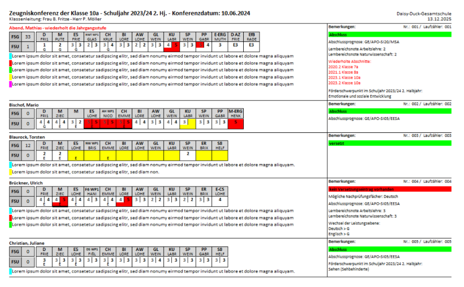

# Leistungsübersichten für die Oberstufe

**Veröffentlicht am 26.01.2026.**

Die Basissammlung enthält Leistungsübersichten für die Oberstufe und Konferenzen.

**Download (sind in der Basissammlung):**
https://github.com/SVWS-NRW/Schild-NRW-3-Reports/releases

**Anleitung:**
https://schild3.svws-nrw.de/reporting/basisreports/basisreports-downloads-themenuebersicht.html#leistungsubersichten-und-bescheinigungen

### Hier mal ein Beispiel  für die Q2:

### Oder als Einzelansicht:

### Auch für die Sek-I und für die Grundschule gibt es Übersichten:

[Weitere Lösungen](/beratung/) · [Hinweise nach Datum](/wissen/aktuelles)
